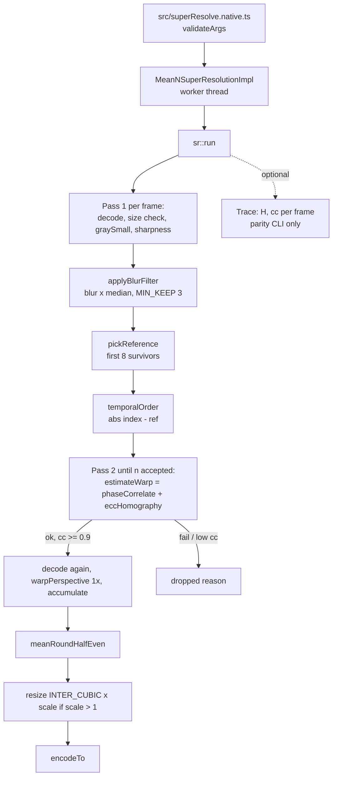

# lab-parity-mean Design

**Spec**: `.specs/features/lab-parity-mean/spec.md`
**Status**: Draft

---

## Spike results (2026-11-16, L-006)

Run in `/tmp/ecc-spike` against the opencv-mobile 4.14.0 macOS framework this repo downloads.

| Check | Result |
| ----- | ------ |
| `video` module in opencv-mobile | Present (`findTransformECC`, `phaseCorrelate` exported). Vendoring is needed for abort safety, not for availability. |
| Non-convergence paths in `ecc.cpp` 4.14.0 | Exactly two `CV_Error(StsNoConv)`: `rho` NaN, `lambda_d <= 0`. Every other `CV_Assert`/`CV_Error` is an input check fixed by construction (1 channel CV_32F, 3×3 CV_32F map, `MOTION_HOMOGRAPHY`, COUNT\|EPS criteria). |
| Vendored copy (2 errors → `return false`) vs library `cv::findTransformECC` | Bit-identical H and rho on a converging homography. |
| Flat input / 900 px shift | Returns `false`, no abort. |
| Uncorrelated noise | Converges with rho 0.025 → dropped by cc < 0.9. |
| Python cv2 4.12 (lab-like) vs vendored C++ 4.14, `phase_shift` + ECC | Shift equal to 1e-9 px, cc equal to 1e-7, H entries differ ≤ 1.6e-6 (well under the 0.05 px corner tolerance). The lab does not pin OpenCV (system package), so this is the version risk and it is negligible. |
| Pre-existing: `yarn test:native` did not link on macOS | CMake de-duplicated the second `-framework`; fixed in `cmake/OpenCVMobile.cmake` with `SHELL:` (46/46 tests pass). |

---

## Architecture Overview

Same layers as today (Spec → JSI adapter → `cpp/sr` → platform registration); only `cpp/sr` is restructured and the data that crosses the layers grows.



### Pass structure and memory

- **Pass 1** decodes every frame once, checks its size against `paths[0]`, keeps only its `graySmall` (CV_32F, long side 1024, ≈ 3 MB) and its sharpness. The full frame is released before the next decode. Keeping `graySmall` means pass 2 does not recompute it, and the lab computes it the same way in `sharpness` and `estimate_warp`, so the values are the same.
- **Pass 2** visits frames in temporal order. Each frame's warp is estimated from the stored gray images. Only accepted frames are decoded a second time (at most `n`), warped and accumulated. Total decodes: at most `frames + n` (every accepted frame, the reference included, is decoded a second time).
- Peak memory estimate (pre-flight after pass 1, before pass 2 allocates the accumulator, AD-004), with `a` = small gray area and `p = w·h`:
  - accumulate phase: `frames·4a` (graySmall) + `12p` (CV_32FC3 accumulator) + `6p` (decoded + warped frame) + `kEccWorkBytes` (96 MiB: ECC jacobian 8a floats and ≈ 15 a-sized float temporaries);
  - finalize phase (graySmall and accumulator released): `3p` (mean) + `3·s²·p` (upscaled);
  - estimate = max of the two. At 12 MP, 30 frames: ≈ 0.40 GiB accumulating, ≈ 0.60 GiB finalizing at scale 4, under the 1 GiB budget.

---

## Code Reuse Analysis

### Existing Components to Leverage

| Component | Location | How to Use |
| --------- | -------- | ---------- |
| `decodeFrame`, `encodeTo`, `isFinite`, `sizeText` | `cpp/sr/Pipeline.cpp` | Keep unchanged (decode guards, lower-case extension encode, JPEG q95) |
| `toFsPath`, `toFileUri`, `uniqueOutputPath`, `lowerExt` | `cpp/sr/Paths.*` | Unchanged |
| `SrError`, codes, `toRejectMessage` | `cpp/sr/Errors.h`, `ErrorMapping.*` | Unchanged; no new error code |
| Memory pre-flight pattern | `estimatePeakBytes` + `kMemoryBudgetBytes` | New formula, same budget and check point |
| Phase correlation guards | `cpp/sr/Align.cpp` (`lround(side) < 2`, finite shift, `clone()` before `phaseCorrelate`) | Keep the guards; replace the NCC acceptance with ECC |
| Host test fixtures | `cpp/tests/fixtures.*` | Extend with homography / blur / unrelated-frame burst writers |
| JS validation mirror | `src/validate.ts` ↔ `cpp/sr/Validate.cpp` | Same rule table, new bounds |
| `opencv_mobile_find_package` | `cmake/OpenCVMobile.cmake` | Parity CLI links the same OpenCV as the tests |

### Integration Points

| System | Integration Method |
| ------ | ------------------ |
| Codegen | New object alias `SuperResolveDropped` and new fields in `SuperResolveOptions`/`SuperResolveResult` in `src/NativeMeanNSuperResolution.ts`; C++ adapter updates its `Bridging<>` aliases (template arity changes, compile errors surface in `MeanNSuperResolutionImpl.h`) |
| Android build | `android/CMakeLists.txt` `add_library` gains the new `.cpp` files (`Ecc.cpp`, `Burst.cpp`) |
| iOS build | Podspec glob `cpp/**` already picks up new files |
| burst-sr-lab | Parity script imports `filters`, `align`, `methods` from `$LAB_DIR/algorithms/mfnr` (and `tools/` via `align.py`'s own `sys.path` insert) |

---

## Components

### Vendored ECC

- **Purpose**: Homography ECC that reports non-convergence instead of aborting.
- **Location**: `cpp/sr/vendor/Ecc.h`, `cpp/sr/vendor/Ecc.cpp`
- **Interfaces**:
  - `std::optional<double> eccHomography(const cv::Mat& templ32f, const cv::Mat& input32f, cv::Mat& warp3x3f, int maxIter, double eps, int gaussFiltSize)` — returns rho, or `nullopt` on non-convergence or non-finite warp.
- **Changes from upstream** (listed in the file header; the upstream license header — Intel BSD-style, inside the Apache-2.0 OpenCV project — is kept verbatim): copied from OpenCV 4.14.0 `modules/video/src/ecc.cpp` (helpers `image_jacobian_homo_ECC`, `project_onto_jacobian_ECC`, `update_warping_matrix_ECC` and the body of `findTransformECCWithMask`); `precomp.hpp` replaced by public headers; wrapped in `namespace sr::vendor`; non-homography jacobian helpers and mask branches removed (no masks passed); the two `CV_Error(StsNoConv)` become `return std::nullopt`; after `update_warping_matrix_ECC`, `if (!cv::checkRange(map)) return std::nullopt;` (keeps a diverging map out of `warpPerspective`).
- **Dependencies**: `core`, `imgproc`.

### Burst selection (pure functions)

- **Purpose**: The lab's frame bookkeeping, testable without images.
- **Location**: `cpp/sr/Burst.h`, `cpp/sr/Burst.cpp`
- **Interfaces**:
  - `cv::Mat graySmall(const cv::Mat& bgr, double& s)` — `cvtColor` BGR2GRAY, `resize(fx=fy=1024/longSide, INTER_AREA)`, `convertTo(CV_32F)`; `s` returned.
  - `double sharpness(const cv::Mat& graySmall32f)` — variance of `Laplacian(CV_32F)` (`meanStdDev`, σ²).
  - `struct Drop { int index; std::string reason; };`
  - `std::vector<int> applyBlurFilter(const std::vector<double>& sharp, double ratio, std::vector<Drop>& dropped)` — returns kept indices; no-op when `ratio == 0` or fewer than 3 would remain. Median like `np.median` (mean of the two middle values for even counts). Reason: `"sharpness " + fmt("%.2f", s/med) + " of median < " + fmt("%g", ratio) + ", dropped (blur)"`.
  - `int pickReference(const std::vector<int>& kept, const std::vector<double>& sharp)` — argmax over `kept[0..min(8,size))`, first wins.
  - `std::vector<int> temporalOrder(const std::vector<int>& kept, int ref)` — `std::stable_sort` by `|i − ref|`.
- **Reuses**: none (new); formats with `snprintf` to match Python's `%`-style output.

### Align (rewritten)

- **Purpose**: Lab `estimate_warp`: phase-correlation init + ECC homography, mapped to full resolution.
- **Location**: `cpp/sr/Align.h`, `cpp/sr/Align.cpp` (replaces `estimateTransform`)
- **Interfaces**:
  - `struct WarpEstimate { enum class Status { Ok, NoConvergence, LowCorrelation } status; cv::Mat H; /* 3x3 CV_32F, full resolution, ref→frame */ double cc; };`
  - `WarpEstimate estimateWarp(const cv::Mat& refSmall, const cv::Mat& graySmall, double s)` — `phaseCorrelate(ref64.clone(), cur64.clone(), hann64)`; non-finite shift → `NoConvergence`; `H0 = [[1,0,dx],[0,1,dy],[0,0,1]]` float32; `eccHomography(…, 100, 1e-5, 5)`; `nullopt` → `NoConvergence`; `cc < 0.9` → `LowCorrelation`; else `H = inv(S)·H·S` in float32 (like numpy on float32 arrays).
  - `std::string dropReason(const WarpEstimate&)` — `"ECC did not converge, dropped"` or `"ECC cc " + fmt("%.3f", cc) + " < 0.9, dropped"`.
- **Guards** (AD-004): both gray images non-empty, same size, CV_32F, sides ≥ 2 (Hanning/`phaseCorrelate` asserts).

### Pipeline (rewritten `run`)

- **Purpose**: Orchestrates the two passes, mean, upscale and encode.
- **Location**: `cpp/sr/Pipeline.h`, `cpp/sr/Pipeline.cpp`
- **Interfaces**:
  - `struct Request { std::vector<std::string> paths; int n = 8; double blur = 0.8; int scale = 1; std::optional<std::string> outputPath; std::string defaultOutputDir; };`
  - `struct Result { std::string path; int width, height, framesUsed, refIndex; std::vector<int> used; std::vector<Drop> dropped; };`
  - `struct TraceFrame { int index; cv::Mat H; double cc; }; using Trace = std::vector<TraceFrame>;`
  - `Result run(const Request&, Trace* trace = nullptr)` — trace filled for every accepted non-reference frame (parity CLI only).
  - `std::uint64_t estimatePeakBytes(int w, int h, int scale, int frames)`.
  - `void meanRoundHalfEven(const cv::Mat& acc32fc3, int count, cv::Mat& out8uc3)` — per element `std::nearbyint(float(sum) / float(count))`, saturate to [0,255]; matches `np.mean(dtype=float32).round()` (sums are exact integers in float32, ≤ 30·255).
- **Flow**: validate → pass 1 → `applyBlurFilter` → `pickReference` → `temporalOrder` → pre-flight → accumulate reference (identity) → for each next frame while `used.size() < n`: `estimateWarp`, drop or (decode, size re-check, `warpPerspective(INTER_LINEAR | WARP_INVERSE_MAP, BORDER_REPLICATE)`, `cv::accumulate`) → `used.size() < 2` → `E_ALIGNMENT_FAILED` (message lists the drops) → mean → release accumulator → `resize(fx=fy=scale, INTER_CUBIC)` if `scale > 1` → encode.
- Frames dropped by ECC after `n` is reached are never visited (same set as the lab, spec assumption).

### Validation

- **Location**: `cpp/sr/Validate.cpp`, `src/validate.ts`
- **Rules**: `paths` 3..30 non-empty strings; `n` integer 2..30; `blur` finite in [0, 1]; `scale` integer 1..4; `outputPath` extension `.jpg/.jpeg/.png`. JSI adapter maps missing options to defaults (`n` 8, `blur` 0.8, `scale` 1) and non-integral `n`/`scale` to 0 (rejected), like `toScale` today. Non-finite `blur` maps to −1 (rejected).

### TurboModule spec and adapter

- **Location**: `src/NativeMeanNSuperResolution.ts`, `src/types.ts`, `cpp/MeanNSuperResolutionImpl.{h,cpp}`
- **Spec**:

```ts
export type SuperResolveOptions = { n?: number; blur?: number; scale?: number; outputPath?: string };
export type SuperResolveDropped = { index: number; reason: string };
export type SuperResolveResult = {
  path: string; width: number; height: number; framesUsed: number;
  refIndex: number; used: number[]; dropped: SuperResolveDropped[];
};
```

- Public `types.ts` keeps narrow types (`scale?: 1 | 2 | 3 | 4`) and docs; index re-exports `SuperResolveDropped`.
- Adapter: `Bridging<>` aliases for the three generated structs; `std::vector<double>` for `used`, `std::vector<SuperResolveDropped>` for `dropped`.

### Parity harness

- **Purpose**: LP-PAR-01..05, run locally (the lab and its sessions are not in CI).
- **Location**: `cpp/tests/parity_cli.cpp` (target `sr_parity_cli`, built by `yarn test:native`), `scripts/parity/` (`synth.py`, `lab_golden.py`, `compare.py`, `run.py`), `package.json` script `test:parity`.
- **Flow**: `run.py --lab $LAB_DIR [--sessions <dir>]` → `synth.py` writes deterministic bursts into `build/parity/<name>/frames/frame_NNN.jpg` → for each burst: `lab_golden.py` (imports lab `apply_filters`, `pick_ref`, `align`, `methods.mean`, `methods.bicubic_x2`; replicates `run.py:112-124` ordering; writes `golden.json` with dropped/ref/used/H/cc and `mean.png`, `mean_x2.png`) and `sr_parity_cli <frames...> --n 8 --out <dir>` (writes `native.json` from `Result` + `Trace`, PNG outputs at scale 1 and 2) → `compare.py` applies the spec tolerances and prints one pass/fail row per burst.
- **Lab ↔ native homography**: the lab's `estimate_warp` returns the full-resolution H per frame; `lab_golden.py` calls it directly for the frames `align` kept, so it does not need to patch the lab.
- **Synthetic bursts** (`synth.py`, numpy seed fixed): `homography` (12 frames, 1600×1200 multi-scale texture + text, random homographies within ±6 px / ±0.4° / ±0.3 % scale, Gaussian noise σ 4, JPEG q95); `blurred` (same + frames 3, 6 and 9 Gaussian-blurred σ 2.0, the lab's `filtro-de-frames` test); `unrelated` (frame 5 replaced by another scene → ECC low cc or no convergence); `small` (640×480, gray image upscaled to 1024).

---

## Data Models

```ts
type SuperResolveDropped = { index: number; reason: string };
// index: position in `paths`. reason: lab log text without "frame NNN: ".
```

`golden.json` / `native.json` (parity only):

```json
{ "refIndex": 2, "used": [2, 1, 3, 0, 4, 5, 6, 7],
  "dropped": [{ "index": 9, "reason": "sharpness 0.41 of median < 0.8, dropped (blur)" }],
  "warps": [{ "index": 1, "H": [[...],[...],[...]], "cc": 0.987 }] }
```

---

## Error Handling Strategy

| Error Scenario | Handling | User Impact |
| -------------- | -------- | ----------- |
| ECC NaN / `lambda_d <= 0` / diverging map | Vendored ECC returns `nullopt` → frame in `dropped` | Call still resolves if ≥ 2 frames accepted |
| ECC cc < 0.9 | `LowCorrelation` → `dropped` | Same |
| Non-finite phase shift, tiny gray image | Guard before OpenCV → `NoConvergence` | Same; no abort |
| < 2 accepted | `E_ALIGNMENT_FAILED: only 1 frame(s) usable…` | Rejection, as today |
| Size mismatch | `E_SIZE_MISMATCH` in pass 1 (before any warp) | As today, earlier |
| Decode failure | `E_DECODE_FAILED` with index (pass 1, or pass 2 if the file changed) | As today |
| Memory estimate > 1 GiB | `E_INTERNAL` before pass 2 allocates | As today, new formula |
| Bad `n` / `blur` / count | `E_INVALID_ARGUMENT` in JS and C++ | New messages |

---

## Tech Decisions

| Decision | Choice | Rationale |
| -------- | ------ | --------- |
| ECC source | Vendor `ecc.cpp` 4.14.0 (homography path only) | Spike: identical to the library function, no abort; AD-006 |
| Keep `graySmall` from pass 1 | Yes (≈ 3 MB per frame, ≤ 90 MB at 30 frames) | Saves up to 29 full decodes; same values as recomputing |
| Accumulator | `CV_32FC3` + `cv::accumulate` (exact integer sums) and a custom half-to-even mean | `convertTo(…, 1/n)` multiplies by an inexact reciprocal and can round `.5` cases differently from numpy |
| Sharpness variance | `meanStdDev` (double) | numpy computes the float32 variance with pairwise summation; relative difference ~1e-6 only matters exactly at the 0.80 threshold or for reference ties. Accepted; the parity harness would show it. |
| `H = S⁻¹·H·S` precision | float32, like numpy on float32 arrays | Closest to the lab |
| Parity in CI | No (local `yarn test:parity`) | Needs the lab checkout and Python OpenCV; host GoogleTests in CI cover the behavior with exact expected values |
| macOS host link fix | `SHELL:-framework X` | Pre-existing bug found in the spike |
